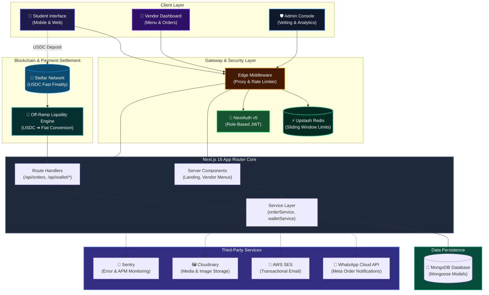
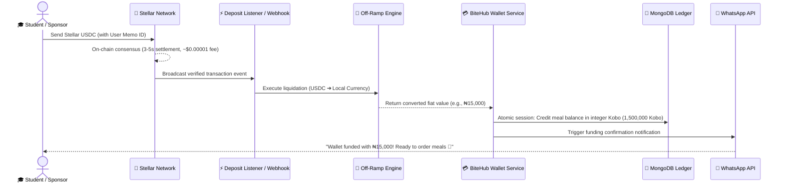
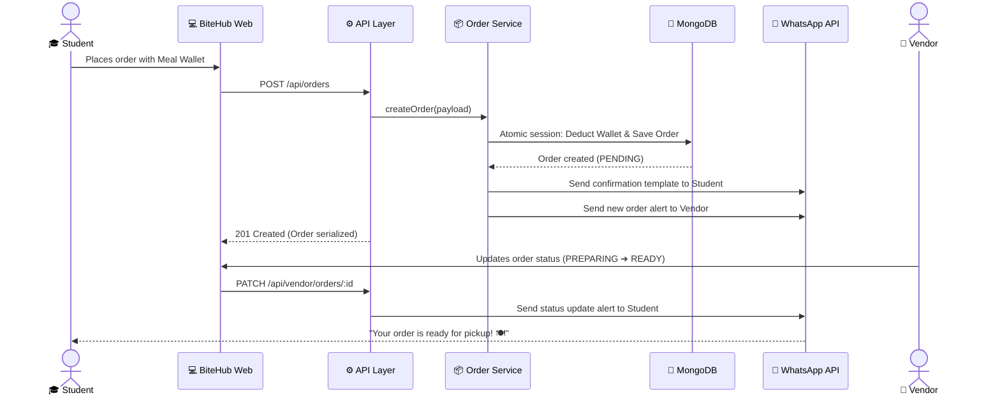
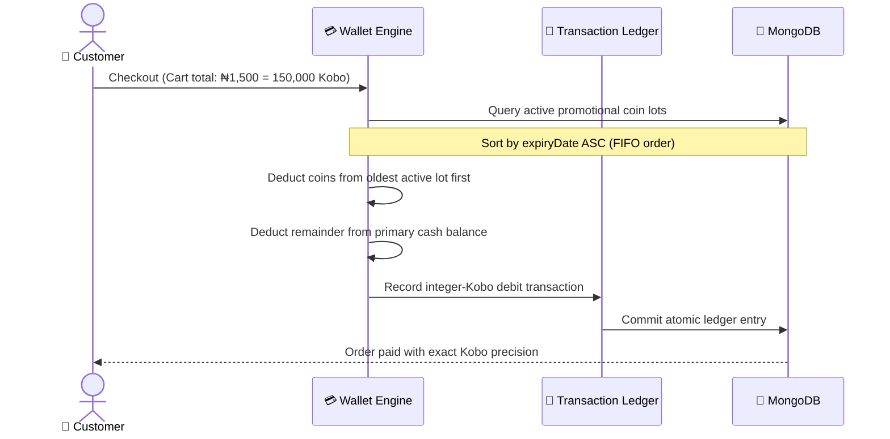

# BiteHub

<p align="center">
  
</p>

<p align="center">
  <strong>A high-performance campus food ordering platform connecting university students with local vendors — built on the Stellar Network.</strong>
</p>

<p align="center">
  <a href="https://nextjs.org/"></a>
  <a href="https://www.typescriptlang.org/"></a>
  <a href="https://stellar.org/"></a>
  <a href="https://react.dev/"></a>
  <a href="https://www.mongodb.com/"></a>
  <a href="https://tailwindcss.com/"></a>
  <a href="https://vitest.dev/"></a>
  <a href="LICENSE"></a>
</p>

---

## 📖 Overview

**BiteHub** solves the daily friction of campus dining. Built as a full-stack, real-time web application using the **Next.js 16 App Router** and powered by the **Stellar Network**, BiteHub empowers university students to discover campus-vetted vendors, customize meals, track order lifecycles in real time, and pay through an integer-precision meal wallet. 

By building on **Stellar**, BiteHub enables students, parents, and international sponsors to fund meal balances instantly using **Stellar USDC**. Deposits settle in 3–5 seconds with fractions-of-a-cent fees, automatically off-ramp into local currency value, and credit the student's digital wallet in integer **Kobo** precision. Local culinary vendors receive a dedicated management dashboard with live order pipelines, automated WhatsApp dispatch alerts, and granular menu control.

---

## 🏛️ System Architecture



---

## 🔄 Core Workflows

### 1. Stellar USDC Wallet Funding & Automated Off-Ramp Flow

Customers can fund their digital meal wallet globally using **Stellar USDC**. Deposits settle on-chain within seconds, convert through our automated off-ramp rails, and credit the customer's wallet in integer Kobo (`₦1.00 = 100 Kobo`) with zero manual intervention:



### 2. Order Lifecycle & Real-Time WhatsApp Dispatch



### 3. Digital Meal Wallet & FIFO Coin Deduction



---

## ✨ Features

### 🎓 For Students & Customers
- **Stellar USDC Wallet Funding:** Top up your meal balance from anywhere in the world using Stellar USDC with near-zero network fees.
- **Automated Off-Ramping:** Instant conversion from digital dollars into local currency credit with integer **Kobo** precision.
- **Campus-Centric Discovery:** Filter restaurants, food trucks, and cafeterias specifically within your university campus.
- **Digital Meal Wallet:** Fast checkout via pre-funded student balances with zero transaction failure rates.
- **Gamified Rewards:** Promotional coin lots with automatic First-In-First-Out (FIFO) expiration handling.
- **Live WhatsApp Notifications:** Real-time updates delivered to your WhatsApp when food is pending, preparing, or ready for pickup.
- **Responsive PWA Experience:** Smooth mobile navigation optimized for fast touch interactions and weak campus network connections.

### 🏪 For Food Vendors
- **Live Order Kanban:** Real-time order queue with instant status updates (`Pending`, `Preparing`, `Ready`, `Completed`, `Cancelled`).
- **Dynamic Menu Management:** Create categories, upload meal photography via Cloudinary, and toggle real-time item availability.
- **Operating Hours & Profile:** Configure opening/closing hours, campus operating locations, and support contact details.
- **Automated Customer Dispatch:** Automatically inform customers via WhatsApp when orders are ready without manual messaging.

### 🛡️ For Administrators
- **Vendor Onboarding Pipeline:** Rigorous vetting, KYC document review, and status approval for new vendors.
- **Campus Oversight:** Manage multi-campus catalogs, user moderation, and platform health.
- **Audit Logging & Analytics:** Track revenue volumes, order fulfillment times, and platform metrics.

---

## 🛠️ Tech Stack

| Domain | Technology | Purpose |
|---|---|---|
| **Blockchain** | [Stellar Network](https://stellar.org/) | Fast, low-cost cross-border USDC settlement layer for wallet deposits |
| **Framework** | [Next.js 16](https://nextjs.org/) (App Router) | Server-rendered pages, streaming architecture, and edge API routes |
| **Language** | [TypeScript](https://www.typescriptlang.org/) | Strict end-to-end type safety, domain interfaces, and schema inference |
| **State Management** | [React Query](https://tanstack.com/query/latest) + Context | Server-state caching, optimistic mutations, and localized UI state |
| **Database** | [MongoDB](https://www.mongodb.com/) + [Mongoose](https://mongoosejs.com/) | Document persistence with indexed queries and atomic sessions |
| **Authentication** | [NextAuth v5](https://authjs.dev/) | Role-based JWT session strategies with isolated provider credentials |
| **Styling** | [Tailwind CSS](https://tailwindcss.com/) + [shadcn/ui](https://ui.shadcn.com/) | Custom design-token styling adhering to CSS custom variables |
| **Validation** | [Zod](https://zod.dev/) | Runtime validation across forms, server actions, and HTTP endpoints |
| **Rate Limiting** | [Upstash Redis](https://upstash.com/) | Sliding-window edge rate limiting across authenticated and public endpoints |
| **Notifications** | [Meta WhatsApp Cloud API](https://developers.facebook.com/docs/whatsapp) | Transactional notifications sent directly to student and vendor WhatsApp |
| **Email Delivery** | [AWS SES](https://aws.amazon.com/ses/) + [React Email](https://react.email/) | Password resets, vendor approval notifications, and email verification |
| **Media Hosting** | [Cloudinary](https://cloudinary.com/) | Compressed menu image uploads, transformations, and global CDN delivery |
| **Testing** | [Vitest](https://vitest.dev/) | Financial ledger invariants, OTP verification, and high-concurrency race condition tests |
| **Monitoring** | [Sentry](https://sentry.io/) | Performance monitoring and real-time crash reporting |

---

## ⚙️ Prerequisites

Before running the application locally, ensure you have:

- **Node.js**: `v18.18.0` or higher (Node 20+ LTS recommended)
- **pnpm**: `v9.0.0` or higher (`npm install -g pnpm`)
- **MongoDB**: A running local MongoDB daemon or a MongoDB Atlas connection URI

---

## 🚀 Getting Started

### 1. Clone & Install

```bash
git clone https://github.com/legend4tech/BiteHub.git
cd BiteHub
pnpm install
```

### 2. Environment Configuration

Create a `.env.local` file in the project root:

```bash
touch .env.local
```

Fill in the required environment variables:

```env
# ── Core App ────────────────────────────────────────────────────────────────
NEXT_PUBLIC_APP_URL=http://localhost:3000
NEXT_PUBLIC_API_URL=http://localhost:3000/api
AUTH_SECRET=place_secret_here
MAINTENANCE_MODE=false

# ── Database ────────────────────────────────────────────────────────────────
MONGODB_URI=place_secret_here
MONGODB_DB=place_secret_here

# ── Upstash Redis (Rate Limiting) ───────────────────────────────────────────
UPSTASH_REDIS_REST_URL=place_secret_here
UPSTASH_REDIS_REST_TOKEN=place_secret_here

# ── Media Uploads (Cloudinary) ──────────────────────────────────────────────
CLOUDINARY_CLOUD_NAME=place_secret_here
CLOUDINARY_API_KEY=place_secret_here
CLOUDINARY_API_SECRET=place_secret_here

# ── WhatsApp Business API (Meta) ────────────────────────────────────────────
WHATSAPP_ACCESS_TOKEN=place_secret_here
WHATSAPP_PHONE_NUMBER_ID=place_secret_here
WHATSAPP_WEBHOOK_VERIFY_TOKEN=place_secret_here

# ── Email (AWS SES) ─────────────────────────────────────────────────────────
AWS_ACCESS_KEY_ID=place_secret_here
AWS_SECRET_ACCESS_KEY=place_secret_here
AWS_REGION=place_secret_here
EMAIL_FROM=place_secret_here

# ── Error Monitoring ────────────────────────────────────────────────────────
NEXT_PUBLIC_SENTRY_DSN=place_secret_here
```

### 3. Launch Development Server

```bash
pnpm run dev
```

Visit [http://localhost:3000](http://localhost:3000) in your browser.

### 4. Run Automated Test Suites

BiteHub enforces strict automated test verification across unit logic, financial invariants, and concurrency:

```bash
pnpm test          # Run all Vitest suites once
pnpm test:watch    # Interactive watch mode for TDD
```

---

## 🤝 Contributing Guidelines

We welcome contributions from the community! Because BiteHub handles financial transactions and high-concurrency order pipelines, all contributors (both human developers and AI coding assistants) must follow our strict architectural rules.

> [!IMPORTANT]
> **Read the complete guide before opening a PR:**  
> 👉 **[BiteHub Contribution Guide (CONTRIBUTING.md)](CONTRIBUTING.md)**

### Key Codebase Rules

1. **Hard Limit: ≤ 450 Lines Per File:**  
   Every file must remain under 450 lines. Large forms must be split into dedicated `*Form.tsx` components, queries into services, and views into domain components.
2. **Strict Separation of Concerns:**  
   - UI components never query the database directly.
   - API route handlers validate with Zod and delegate business logic to `lib/services/`.
   - All Mongoose documents returned from `.lean()` must pass through a serializer in `lib/serializers.ts`.
3. **Semantic Design Tokens Only:**  
   Never hardcode raw hex values or generic Tailwind colors (`#ff6b00`, `bg-orange-500`). Always use semantic tokens defined in `app/globals.css` (`bg-primary`, `text-foreground`, `border-border`).
4. **The `InKobo` Financial Rule:**  
   Never represent monetary values as floating-point numbers. All balances, coin bonuses, fees, and prices must be stored and computed in integer **Kobo** (`₦1.00 = 100 Kobo`).
5. **Zero Errors Pre-PR Gate:**  
   Before opening a Pull Request, you must verify locally:
   ```bash
   pnpm run build   # Must succeed with ZERO TypeScript errors
   pnpm test        # Must pass 100% of unit, concurrency, and financial invariant suites
   ```

---

## 📄 License

This project is licensed under the **MIT License** — see the [LICENSE](LICENSE) file for details.# BiteHub

BiteHub is a campus food ordering platform designed to connect students with local food vendors around their university campus. It provides a seamless ordering experience for students and a robust dashboard for vendors to manage their menus, orders, and store settings.

## 🌟 Features

### For Students
- **Campus-specific Filtering:** Browse vendors and menus specific to your campus or university.
- **Real-time Order Tracking:** Get updates on your order status.
- **Seamless Ordering:** Easy-to-use cart and checkout flow.
- **WhatsApp Notifications:** Receive order updates directly via WhatsApp.

### For Vendors
- **Vendor Dashboard:** Manage your store profile, operating hours, and contact details.
- **Menu Management:** Add, edit, toggle availability, and delete menu items.
- **Order Management:** View incoming orders and update their status (Pending, Preparing, Ready, Completed, Cancelled).
- **Automated Notifications:** Customers receive automated WhatsApp alerts when their order status changes.

### For Admins
- **Platform Management:** Oversee vendors, users, and platform settings.
- **Vendor Onboarding:** Vetting and account creation for new vendors.

## 🚀 Tech Stack

- **Framework:** [Next.js 16 (App Router)](https://nextjs.org/)
- **Language:** [TypeScript](https://www.typescriptlang.org/)
- **Database:** [MongoDB](https://www.mongodb.com/) via [Mongoose](https://mongoosejs.com/)
- **Authentication:** [NextAuth v5 (Auth.js)](https://authjs.dev/)
- **State Management:** [React Query](https://tanstack.com/query/latest) (server state) + React Context (local state)
- **Styling:** [Tailwind CSS](https://tailwindcss.com/) + [shadcn/ui](https://ui.shadcn.com/)
- **Validation:** [Zod](https://zod.dev/)
- **Email:** [Resend](https://resend.com/) + React Email
- **File Uploads:** [Cloudinary](https://cloudinary.com/)
- **Notifications:** WhatsApp Business API (Meta)
- **Rate Limiting:** [Upstash Redis](https://upstash.com/)
- **Monitoring:** [Sentry](https://sentry.io/)

## ⚙️ Prerequisites

Before you begin, ensure you have the following installed:
- **Node.js** (v18 or higher recommended)
- **pnpm** (Package manager used in this project)
- **MongoDB** (Local instance or Atlas URI)

## 🛠️ Installation & Local Development

1. **Clone the repository:**
   ```bash
   git clone https://github.com/legend4tech/BiteHub.git
   cd BiteHub
   ```

2. **Install dependencies:**
   ```bash
   pnpm install
   ```

3. **Configure Environment Variables:**
   Copy the `.env.example` file (or create a `.env.local` file) and fill in the required values based on the section below.
   ```bash
   touch .env.local
   ```

4. **Run the development server:**
   ```bash
   pnpm run dev
   ```
   Open [http://localhost:3000](http://localhost:3000) with your browser to see the application.

## 🔐 Environment Variables

You need to set up the following environment variables in your `.env.local` file for the application to function correctly:

### Core Configuration
```env
# URL of your Next.js application
NEXT_PUBLIC_APP_URL=http://localhost:3000
NEXT_PUBLIC_API_URL=http://localhost:3000/api

# Authentication Secret (Generate one using: openssl rand -base64 32)
AUTH_SECRET=your_nextauth_secret

# Maintenance mode toggle ("true" or "false")
MAINTENANCE_MODE=false
```

### Database
```env
# MongoDB Connection String
MONGODB_URI=mongodb+srv://<user>:<password>@cluster.mongodb.net
MONGODB_DB=bitehub_dev
```

### Email (Resend)
```env
RESEND_API_KEY=your_resend_api_key
EMAIL_FROM=BiteHub <no-reply@bitehubapp.com>
EMAIL_TOKEN_EXPIRY_MINUTES=60
PASSWORD_RESET_EXPIRY_MINUTES=15
```

### Media Uploads (Cloudinary)
```env
CLOUDINARY_CLOUD_NAME=your_cloud_name
CLOUDINARY_API_KEY=your_api_key
CLOUDINARY_API_SECRET=your_api_secret
```

### Rate Limiting (Upstash Redis)
```env
UPSTASH_REDIS_REST_URL=your_upstash_url
UPSTASH_REDIS_REST_TOKEN=your_upstash_token
```

### WhatsApp Notifications (Meta API)
```env
WHATSAPP_ACCESS_TOKEN=your_meta_access_token
WHATSAPP_PHONE_NUMBER_ID=your_whatsapp_phone_number_id
WHATSAPP_WEBHOOK_VERIFY_TOKEN=your_custom_webhook_verify_token
```

### Error Monitoring (Sentry)
```env
NEXT_PUBLIC_SENTRY_DSN=your_sentry_dsn
```

## 🤝 Contributing

We welcome contributions from the community! Please read our [Contribution Guidelines](CONTRIBUTING.md) to understand our architectural patterns, coding standards, and how to submit a pull request. 

**Key Highlights:**
- Follow the strict **separation of concerns** (Pages, Components, Hooks, Services, Models).
- Ensure **all colors** use design tokens from `app/globals.css`. No hardcoded hex values or generic Tailwind colors.
- Run `pnpm run build` locally to ensure there are **zero TypeScript errors** before opening a PR.

## 📄 License

[MIT License](LICENSE)
