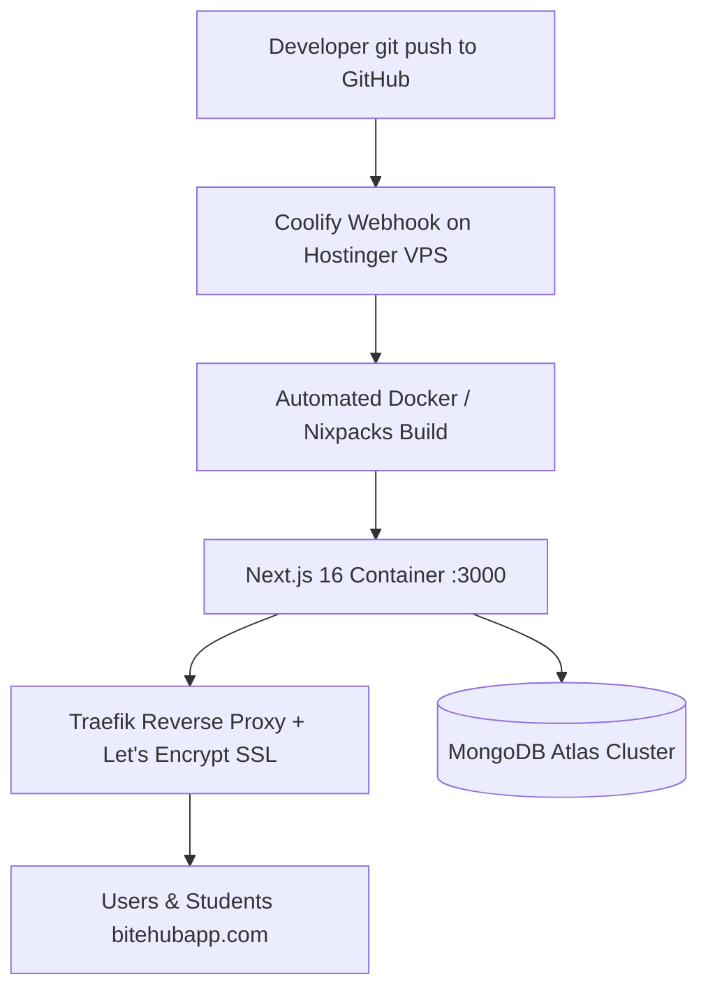

# BiteHub: Hostinger VPS & Coolify Deployment Guide
**Self-Hosted Next.js 16 Infrastructure Migration from Vercel**

---

## 1. Overview & Architecture

This guide covers moving BiteHub from Vercel to a self-hosted **Hostinger VPS** using **Coolify** (the open-source, self-hosted Vercel alternative). 

### Why This Setup?
- **Cost Efficiency:** Fixed monthly cost (~$7–$10/mo) with zero bandwidth or build-minute penalty overages.
- **Vercel-like Experience:** Automated `git push` deployments, instant rollbacks, preview deployments, and free automated Let's Encrypt SSL certificates.
- **Data Protection:** Database remains on **MongoDB Atlas**, meaning your server only runs compute. If the VPS ever needs a reset, no data is lost.



---

## 2. Phase 1: Hostinger VPS Purchase & Initial Setup

### 1. Plan Selection
- **Recommended Plan:** **Hostinger KVM 2** (2 vCPUs, 8 GB RAM, 100 GB NVMe).
- **Operating System:** Choose **Ubuntu 24.04 64-bit**.
- **Datacenter Location:** Select **Europe (France/Germany or UK)** for lowest latency to Nigerian ISPs.

### 2. Configure Firewall Ports in Hostinger hPanel
Navigate to your VPS in Hostinger hPanel $\rightarrow$ **Security** $\rightarrow$ **Firewall** $\rightarrow$ Create a Profile and open these incoming ports:
- `22` (SSH - Remote terminal access)
- `80` (HTTP - Let's Encrypt domain challenge)
- `443` (HTTPS - Secure web traffic)
- `8000` (Coolify Dashboard initial web access)

---

## 3. Phase 2: Server Hardening & Swap Memory Optimization

Next.js production compilation (`next build`) is CPU- and memory-intensive. Setting up a 4GB swap space guarantees your builds never crash from `Out Of Memory` (OOM) errors.

### 1. Connect via SSH
Open your terminal and connect to your server:
```bash
ssh root@<YOUR_HOSTINGER_VPS_IP>
```
*(Enter your root password set during Hostinger setup)*

### 2. Update System Packages
```bash
apt update && apt upgrade -y
apt install -y curl wget git ufw htop
```

### 3. Configure 4GB Swap Space
```bash
fallocate -l 4G /swapfile
chmod 600 /swapfile
mkswap /swapfile
swapon /swapfile
echo '/swapfile none swap sw 0 0' | tee -a /etc/fstab
```
*(Verify swap by running `free -h` — you should see 4.0Gi in the Swap row)*

---

## 4. Phase 3: Install Coolify

Run the official one-line automated installation script:

```bash
curl -fsSL https://cdn.coollabs.io/coolify/install.sh | bash
```

The script automatically installs **Docker**, **Docker Compose**, and **Coolify** services. Once complete (~2 to 3 minutes), you will see:
```
Coolify is installed and running!
Access it at: http://<YOUR_HOSTINGER_VPS_IP>:8000
```

### Initial Dashboard Onboarding
1. Open your browser and visit: `http://<YOUR_HOSTINGER_VPS_IP>:8000`
2. Create your primary Admin account (Name, Email, Password).
3. Select **localhost** as your default server destination.

---

## 5. Phase 4: Connecting GitHub & Deploying BiteHub

### 1. Connect GitHub to Coolify
1. In the Coolify sidebar, go to **Sources** $\rightarrow$ **Add Source** $\rightarrow$ **GitHub App**.
2. Click **Install GitHub App** and select your GitHub account (`legend4tech`).
3. Grant access to your repository: `legend4tech/BiteHub`.

### 2. Create the Project & Application
1. In Coolify, go to **Projects** $\rightarrow$ **Default** $\rightarrow$ **Add Resource** $\rightarrow$ **Private Repository (with GitHub App)**.
2. Select `legend4tech/BiteHub`.
3. Set your production branch (e.g., `main` or `feature/customer-accounts-wallet`).
4. Set **Build Pack** to **Nixpacks** (recommended by Coolify for Next.js).

### 3. Build & Runtime Configuration
In the application configuration tab:
- **Port:** `3000`
- **Install Command:** `pnpm install`
- **Build Command:** `pnpm run build`
- **Start Command:** `pnpm run start`

### 4. Configure Environment Variables
Navigate to the **Environment Variables** tab in your Coolify application and add your production credentials:

```env
NODE_ENV=production
NEXT_PUBLIC_APP_URL=https://bitehubapp.com
NEXT_PUBLIC_API_URL=https://bitehubapp.com/api
AUTH_SECRET=your_production_auth_secret
MONGODB_URI=mongodb+srv://<username>:<password>@cluster.mongodb.net
MONGODB_DB=bitehub_prod
AWS_ACCESS_KEY_ID=your_aws_access_key
AWS_SECRET_ACCESS_KEY=your_aws_secret_key
AWS_REGION=eu-west-1
EMAIL_FROM=BiteHub <no-reply@bitehubapp.com>
CLOUDINARY_CLOUD_NAME=your_cloudinary_name
CLOUDINARY_API_KEY=your_cloudinary_key
CLOUDINARY_API_SECRET=your_cloudinary_secret
UPSTASH_REDIS_REST_URL=your_upstash_url
UPSTASH_REDIS_REST_TOKEN=your_upstash_token
MONNIFY_API_KEY=your_monnify_api_key
MONNIFY_SECRET_KEY=your_monnify_secret_key
MONNIFY_CONTRACT_CODE=your_contract_code
MONNIFY_BASE_URL=https://api.monnify.com
```

### 5. Trigger Initial Deployment
Click **Deploy** in the top right corner of the Coolify dashboard. You can watch the real-time build logs as `pnpm install` and `next build` execute.

---

## 6. Phase 5: Domain Configuration & Automated SSL

### 1. Update DNS Records
Log into your domain DNS registrar (Namecheap, GoDaddy, Cloudflare, etc.) and point your domain to the Hostinger VPS IP:

| Type | Name | Content / Value | TTL |
| :--- | :--- | :--- | :--- |
| **A** | `@` | `<YOUR_HOSTINGER_VPS_IP>` | Auto / 300 |
| **A** | `www` | `<YOUR_HOSTINGER_VPS_IP>` | Auto / 300 |

### 2. Bind Domain in Coolify
1. In your BiteHub application settings on Coolify, set the **Domains** field to:
   ```
   https://bitehubapp.com,https://www.bitehubapp.com
   ```
2. Click **Save**. Coolify's built-in reverse proxy (Traefik) automatically requests, validates, and provisions a **free Let's Encrypt SSL certificate**.

---

## 7. Phase 6: MongoDB Atlas Security & Production Verification

### 1. Whitelist VPS IP on MongoDB Atlas
Because your VPS has a **static IP address** (unlike Vercel's rotating IPs), you can lock down your database security:
1. Go to **MongoDB Atlas** $\rightarrow$ **Network Access**.
2. Click **Add IP Address** $\rightarrow$ Enter `<YOUR_HOSTINGER_VPS_IP>/32`.
3. Delete the `0.0.0.0/0` (Allow access from anywhere) rule if you were using it on Vercel.

### 2. Verify Webhook Endpoints
Ensure your external services point to the new domain:
- **Monnify Webhook URL:** `https://bitehubapp.com/api/webhooks/monnify`
- **Monnify Disbursement Webhook:** `https://bitehubapp.com/api/webhooks/monnify/disbursements`
- **Meta WhatsApp Webhook:** `https://bitehubapp.com/api/whatsapp/webhook`

### 3. Automated Backups
In Hostinger hPanel $\rightarrow$ **VPS** $\rightarrow$ **Backups**:
- Ensure **Automated Daily/Weekly Snapshots** are enabled so you can restore the entire server with 1 click if anything ever breaks.

---

## 8. Troubleshooting & Maintenance Commands

### View Live Container Logs
```bash
# SSH into your VPS and list running containers
docker ps

# Stream Next.js application logs
docker logs -f <CONTAINER_ID>
```

### Check Server Resource Usage
```bash
# Monitor real-time CPU, RAM, and Swap utilization
htop
```

### Restart Application via Coolify
You can restart or trigger manual builds anytime directly from the Coolify web dashboard or simply by pushing a new commit to your production GitHub branch:
```bash
git push origin feature/customer-accounts-wallet
```
*(Coolify detects the push and deploys the update with zero downtime)*
