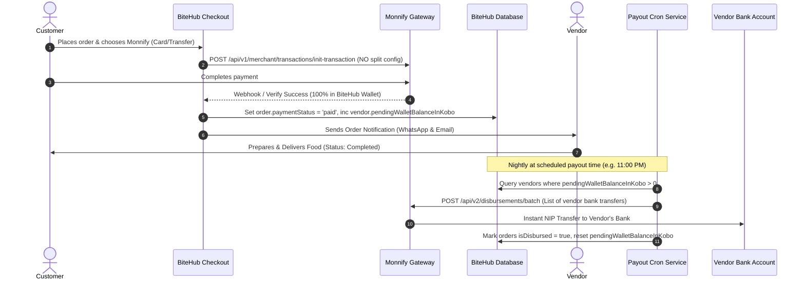
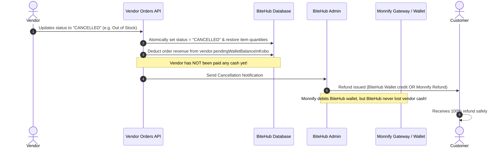

# Monnify Centralized Payout & Split Removal Migration

This document details the architectural transition from real-time **Monnify Sub-Account Split Payments** to **Centralized Collection with Managed Bulk Disbursements**. 

This transition is currently **on pause** pending BiteHub's server migration to Hostinger VPS and static IP whitelisting with Monnify. When ready to execute, use this document as the single source of truth.

---

## 1. Executive Summary & Problem Context

### 1.1 The Operational Incident
When an order paid via Monnify is cancelled, initiating a refund results in **BiteHub bearing 100% of the financial burden while the vendor still receives their full payout**:
1. A customer pays for an order using Card or Bank Transfer via Monnify.
2. Monnify immediately splits the vendor's share into their sub-account ledger.
3. The order is cancelled prior to food fulfillment.
4. BiteHub initiates a refund to make the customer whole.
5. Monnify debits the **full refund amount from BiteHub's primary merchant wallet**.
6. At 10:00 PM, Monnify's automated settlement sweep transfers the split funds from the vendor's sub-account **directly into the vendor's commercial bank account**.
7. **Net Result:** BiteHub loses the vendor's revenue share out of pocket and must manually pursue the vendor for recovery.

### 1.2 Official Monnify Limitation
Monnify's Integration Support confirmed this architectural constraint:
> *"Kindly be informed that refunds are profiled to be debited from the merchant's wallet by default. There is currently no configuration available to ensure that refunds on split payments deduct from the vendor's sub-account rather than debiting the main account entirely.*
>
> *To claw back funds already settled to a sub-account for refunded transactions, we would need to manually create a recall on the specific sub-account, then manually debit the sub-account to credit the merchant's wallet (or the desired account provided)."*

Because Monnify's public API does not support automated sub-account clawback or reverse-split on refunds, continuing with inline split payments creates severe financial exposure.

---

## 2. Architectural Comparison

| Dimension | Current Legacy Flow (Inline Split) | Target Unified Flow (Centralized Payout) |
|---|---|---|
| **Customer Payment Methods** | Card, USSD, Bank Transfer, BiteHub Wallet | Card, USSD, Bank Transfer, BiteHub Wallet *(No change)* |
| **Monnify Checkout Init** | Passes `incomeSplitConfig` with vendor's sub-account code | **Omits `incomeSplitConfig`**; 100% lands in BiteHub's merchant wallet |
| **Vendor Sub-Account Requirement** | Mandatory for checkout; errors if vendor has no sub-account | **Optional**; vendors only need valid bank account details |
| **Vendor Revenue Tracking** | Monnify sub-account internal ledger | BiteHub DB ledger (`vendor.pendingWalletBalanceInKobo`) |
| **Cancellation / Refund Safety** | **High Risk**: Debits BiteHub while vendor still receives 10 PM sweep | **Zero Risk**: Funds remain with BiteHub; vendor pending balance is simply rolled back |
| **Vendor Payout Execution** | Monnify automated 10:00 PM sub-account sweep | BiteHub automated daily cron job via Monnify Bulk Disbursement API |
| **Platform Reconciliation** | Fragmented across Monnify sub-accounts and DB | Fully unified inside BiteHub's ledger and admin dashboards |

---

## 3. Lifecycle Flows & State Transitions

### 3.1 Normal Order Lifecycle (Order Placed $\rightarrow$ Delivered $\rightarrow$ Paid Out)



### 3.2 Cancellation & Refund Lifecycle (Order Cancelled $\rightarrow$ Safe Refund)



---

## 4. Prerequisites & Infrastructure Checklist (Before Unpausing)

Because Monnify's Bulk Disbursement API requires server authentication and pre-funding, the following steps must be completed prior to code deployment:

- [ ] **1. Complete Hostinger VPS Migration:** Deploy BiteHub to the production Hostinger VPS container/Coolify environment.
- [ ] **2. Obtain Static Server IP:** Identify the public static outbound IP address of the Hostinger VPS.
- [ ] **3. Submit IP to Monnify Integration Support:** Email `integration-support@monnify.com` requesting that the outbound IP be whitelisted for the Disbursement API (`/api/v2/disbursements/*`) under your Contract Code.
- [ ] **4. Configure Disbursement Wallet Environment Variable:** Ensure `MONNIFY_WALLET_ACCOUNT_NUMBER` is populated in the production environment.
- [ ] **5. Fund the Disbursement Wallet:** Maintain an operational floating balance in the Monnify disbursement wallet (or enable auto-funding from incoming transaction collections if supported by your Monnify tier).
- [ ] **6. Verify CRON Job Schedule:** Configure a recurring cron trigger (via VPS crontab or external cron service) calling:
  ```bash
  curl -X GET "https://bitehubapp.com/api/cron/disburse-funds" \
       -H "Authorization: Bearer $CRON_SECRET"
  ```

---

## 5. Codebase Blueprint (Implementation Plan)

When the infrastructure prerequisites are met, execute the following changes:

### Step 1: Make `incomeSplitConfig` Optional in `lib/monnify.ts`
Modify `initMonnifyTransaction` in [`lib/monnify.ts`](file:///home/legend4tech/Documents/BiteHub/lib/monnify.ts):
- Make `vendorSubAccountCode` and `vendorSplitAmount` optional parameters.
- Conditionally append `incomeSplitConfig` only if a split is explicitly requested.

```typescript
// lib/monnify.ts
export async function initMonnifyTransaction({
  amount,
  paymentReference,
  customerName,
  customerEmail,
  paymentDescription,
  vendorSubAccountCode,
  vendorSplitAmount,
  redirectUrl,
}: {
  amount: number
  paymentReference: string
  customerName: string
  customerEmail: string
  paymentDescription: string
  vendorSubAccountCode?: string
  vendorSplitAmount?: number
  redirectUrl: string
}) {
  const token = await getMonnifyToken()
  const payload: Record<string, unknown> = {
    amount,
    paymentReference,
    customerName,
    customerEmail,
    paymentDescription,
    currencyCode: "NGN",
    contractCode: MONNIFY_CONTRACT_CODE,
    redirectUrl,
  }

  // Omit incomeSplitConfig for centralized collection:
  if (vendorSubAccountCode && vendorSplitAmount) {
    payload.incomeSplitConfig = [
      {
        subAccountCode: vendorSubAccountCode,
        splitAmount: vendorSplitAmount,
        feeBearer: false,
      },
    ]
  }

  const response = await axiosInstance.post(
    `${MONNIFY_API_URL}/api/v1/merchant/transactions/init-transaction`,
    payload,
    { headers: { Authorization: `Bearer ${token}` } }
  )
  // ...
}
```

### Step 2: Remove Split Config from Checkout in `app/api/orders/[orderId]/pay/route.ts`
In [`app/api/orders/[orderId]/pay/route.ts`](file:///home/legend4tech/Documents/BiteHub/app/api/orders/%5BorderId%5D/pay/route.ts):
- Remove the blocking check requiring `vendor.monnifySubAccountCode`.
- Call `initMonnifyTransaction` without `vendorSubAccountCode` or `vendorSplitAmount`.
- 100% of customer funds will now flow into the BiteHub merchant wallet.

### Step 3: Credit `pendingWalletBalanceInKobo` upon Verification
In [`app/api/orders/[orderId]/verify/route.ts`](file:///home/legend4tech/Documents/BiteHub/app/api/orders/%5BorderId%5D/verify/route.ts) and [`app/api/webhooks/monnify/route.ts`](file:///home/legend4tech/Documents/BiteHub/app/api/webhooks/monnify/route.ts):
- When payment status transitions to `PAID`, atomically increment the vendor's pending balance:
```typescript
await Vendor.findByIdAndUpdate(
  updatedOrder.vendorId,
  { $inc: { pendingWalletBalanceInKobo: updatedOrder.vendorRevenueInKobo } }
)
```

### Step 4: Unify Cancellation Rollback in `app/api/vendor/orders/[id]/route.ts`
In [`app/api/vendor/orders/[id]/route.ts`](file:///home/legend4tech/Documents/BiteHub/app/api/vendor/orders/%5Bid%5D/route.ts):
- Update the cancellation logic so that `pendingWalletBalanceInKobo` is deducted for **both** wallet and Monnify orders:
```typescript
if (order.paymentStatus === PAYMENT_STATUS.PAID && !order.isDisbursed) {
  await Vendor.findByIdAndUpdate(
    order.vendorId,
    { $inc: { pendingWalletBalanceInKobo: -order.vendorRevenueInKobo } },
    { session: cancelSession }
  )
}
```

### Step 5: Update Admin Alert Email Template
In [`emails/AdminOrderCancelledEmail.tsx`](file:///home/legend4tech/Documents/BiteHub/emails/AdminOrderCancelledEmail.tsx):
- Remove the warning text stating: *"you must process a manual refund before the 10:30 PM settlement window closes."*
- Replace with confirmation that the vendor's pending payout has been deducted and the customer refund can be processed safely.

---

## 6. Testing & Validation Strategy

Prior to final release:
1. **Sandbox Transaction Init:** Execute `initMonnifyTransaction` in sandbox without split config; verify that Monnify returns a valid checkout URL and that the entire amount is attributed to the merchant.
2. **Webhook Verification Test:** Simulate Monnify successful charge webhook; verify that `Order.paymentStatus === 'paid'` and `Vendor.pendingWalletBalanceInKobo` is incremented by the exact `vendorRevenueInKobo`.
3. **Cancellation Rollback Test:** Cancel a paid order as a vendor; verify that `Vendor.pendingWalletBalanceInKobo` is decremented atomically and that inventory is restored.
4. **Disbursement Execution Test:** Run `processWalletDisbursements()` against sandbox Monnify with a test vendor bank account; verify that batch disbursement succeeds, `isDisbursed` is set to `true`, and `pendingWalletBalanceInKobo` resets to zero.
